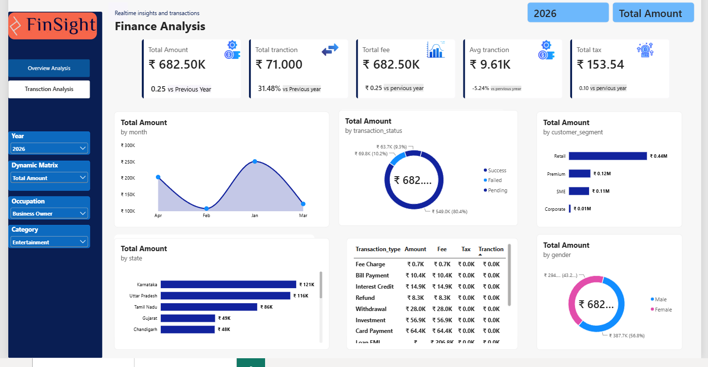

# FinSight – Finance Analysis Dashboard

## 📊 About the Project

FinSight is an interactive Finance Analysis Dashboard built using Power BI to analyze financial transactions and track key financial metrics. The dashboard provides a clear view of transaction amounts, fees, taxes, customer segments, transaction statuses, and other financial activities.

The main goal of this project is to turn raw financial data into meaningful insights that help users understand financial performance, identify trends, and compare results across different categories.

## 🖼️ Dashboard Preview

## 🎯 Project Objectives

- Analyze total transaction amounts and transaction volume.
- Track fees, taxes, and average transaction values.
- Compare financial performance across different years.
- Understand transaction status distribution, including Success, Failed, and Pending.
- Analyze customer segments, occupations, gender, and state-wise performance.
- Explore transaction types to understand how financial activities are distributed.

## 📌 Key Performance Indicators (KPIs)

- **Total Amount:** Overall value of financial transactions.
- **Total Transactions:** Number of transactions recorded.
- **Total Fee:** Total fees associated with transactions.
- **Average Transaction:** Average value per transaction.
- **Total Tax:** Total tax amount recorded.

## 📈 Dashboard Insights

The dashboard presents financial data through interactive charts and visualizations:

- **Monthly Analysis:** Tracks transaction amounts across months to identify changes and trends.
- **Transaction Status:** Shows the distribution of successful, failed, and pending transactions.
- **Customer Segment Analysis:** Compares financial activity across Retail, Premium, SME, and Corporate customers.
- **State-wise Analysis:** Highlights states contributing the highest transaction amounts.
- **Transaction Type Analysis:** Compares amounts, fees, taxes, and transaction values across different transaction types.
- **Gender Analysis:** Examines the distribution of financial transactions by gender.

## 🛠️ Tools & Technologies

- **Power BI Desktop** – Dashboard development and data visualization.
- **Power Query** – Data cleaning and transformation.
- **DAX** – Measures, KPI calculations, and year-over-year comparisons.
- **Data Modeling** – Organizing data for meaningful analysis.

## ⚙️ Dashboard Features

- Interactive filters for year, occupation, and category.
- Dynamic metric selection to analyze different financial measures.
- KPI cards for a quick overview of financial performance.
- Multiple charts for comparing trends and categories.
- A clean layout designed to make financial information easier to understand.

## 💡 What I Learned

While building this project, I practiced transforming financial data into an interactive dashboard, creating DAX measures, working with filters, and presenting data through meaningful visualizations.

This project helped me improve my Power BI skills and understand how data analytics can support financial reporting and business decision-making.

## 🚀 How to Use

1. Clone or download this repository.
2. Download and install Power BI Desktop.
3. Open the `.pbix` file included in the repository.
4. Refresh the data if the source files are available and the paths are configured correctly.
5. Use the filters and visualizations to explore the financial data.

## 👨‍💻 About Me

I am learning Data Analytics by working on practical projects and improving my skills in SQL, Power BI, data visualization, and business analysis.

My goal is to turn data into clear insights that help people make better decisions.

**Connect with me on GitHub:** [Sumeet2027](https://github.com/Sumeet2027)

---

*This project is part of my Data Analytics learning journey, focused on building practical dashboards and developing real-world analytical skills.*
